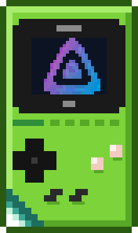
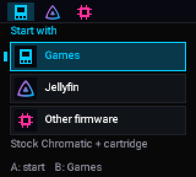
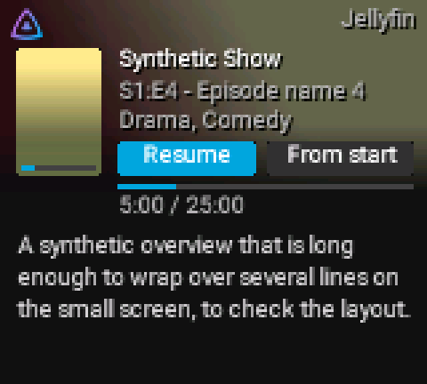
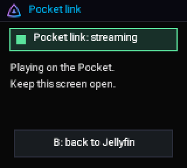
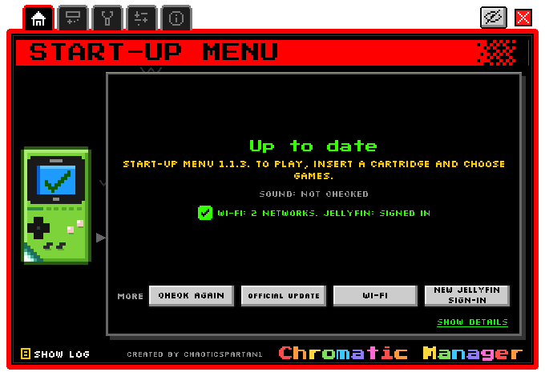

<!-- SPDX-License-Identifier: GPL-3.0-or-later -->
<p align="center">
  
</p>
<p align="center">
  
</p>
<h3 align="center">Jellyfin on your ModRetro Chromatic</h3>
<p align="center">
  A start-up menu for the Chromatic that keeps your games exactly as they are, a Jellyfin app,
  a link to the Analogue Pocket, and a PC tool that installs, checks and undoes everything.
</p>

> **Jellymatic is an independent project, not affiliated with ModRetro or the Jellyfin project.**
> It is not made, endorsed or supported by ModRetro, Analogue or the Jellyfin project. "Jellyfin" is a
> trademark of its owners; "ModRetro" and "Chromatic" are trademarks of ModRetro, Inc.; they are used here
> only to say what this project works with. **Use it at your own risk.** It changes firmware on your
> console. Support is not guaranteed.

## What it is

| Part | What it does |
|---|---|
| **Start-up menu** (ESP32 "launcher") | Shows **Games**, **Jellyfin** and **Other firmware** when you switch the console on. Games is always there and starts the console's own, untouched firmware. |
| **Jellyfin app** | Browse your Jellyfin library and play video with sound on the Chromatic, over Wi-Fi. Wi-Fi and the Jellyfin sign-in are set up on the console itself. |
| **Pocket link** | An updated console chip (FPGA) image, 18.41, that lets the Chromatic feed an Analogue Pocket over a link cable. The Pocket side is [PocketFin](https://github.com/ChaoticSPARTAN1/PocketFin). |
| **Chromatic Manager** | A Windows program (window, text menu, local API and MCP server) that installs, updates, checks, backs up and removes all of the above, one Approve at a time. |
| **Remote Pilot** (bundled) | See and press the console's menus from your PC, in your browser or in the Manager's own tab. The full tool is [RemotePilot](https://github.com/ChaoticSPARTAN1/RemotePilot). |

<p align="center">
  
  
  
</p>
<p align="center">
  
</p>

*All pictures are drawn by the project's own preview renderers with made-up sample data.*

## Remote Pilot: your Chromatic on your PC screen

[**Remote Pilot**](https://github.com/ChaoticSPARTAN1/RemotePilot) lets you **see and control the
Chromatic from your PC**: its live screen, its buttons, its logs and screenshots, over the USB cable or
your home Wi-Fi. A copy is bundled in `remote-pilot/` so the Manager's **Remote Pilot** tab works out of
the box.

Why it is included:

- **Easier set-up and troubleshooting**: read the console's menus and messages on a big screen instead of
  squinting at the handheld, and press its buttons with the mouse.
- **Clean bug reports**: save screenshots and logs with addresses, network names and codes masked.
- **AI assistants, safely**: Claude, Codex or another assistant can test or demo the console through
  Remote Pilot's command line (it presses buttons and reads the screen; it cannot change firmware).
- **Remote demos**: show the console's screens to someone else from your PC.

It is **optional**, stays **on your own PC and network** by default, and is **never needed** to watch
Jellyfin. Full documentation: [RemotePilot](https://github.com/ChaoticSPARTAN1/RemotePilot) and
[docs/Remote-Pilot.md](docs/Remote-Pilot.md).

## Quick start (plain English)

1. **Read [Before you start](docs/Before-you-start.md).** It explains why your games keep working and what
   is changed on the console.
2. **Get the tools** ([What you need](docs/What-you-need.md)): a Windows PC, Python 3.12+, the USB cable,
   openFPGALoader with GWU2X support (for the first backup), and your Chromatic switched **on**.
3. **Open Chromatic Manager**: double-click `Chromatic-Manager-Window.cmd` (first run sets everything up;
   see [Install with Chromatic Manager](docs/Install-with-Chromatic-Manager.md)).
4. **Press the one big button** the Manager shows (Install), then **Approve**. The first time it takes a
   full backup of both chips (about 15 minutes, nothing written), then writes the start-up menu, reads
   every byte back and checks the console starts. The backup's second copy is usually on the same disk;
   put it on another disk or a USB stick for real safety ([Install](docs/Install-with-Chromatic-Manager.md#full-backup-before-any-fpga-change)).
5. **On the console**: switch it off and on, choose **Jellyfin**, press **Select** for setup, add your
   Wi-Fi and sign in to Jellyfin with **Quick Connect**
   ([First run on the console](docs/First-run-on-the-console.md)).
6. **Play**: choose a film or episode and press A ([Using Jellyfin](docs/Using-Jellyfin-on-the-Chromatic.md)).

Something went wrong? [Recovery](docs/Recovery.md) explains what the Manager does by itself, and how to put
everything back, including with ModRetro's **official** update tool.

## Documentation (wiki)

Start at **[docs/Home.md](docs/Home.md)**. Pages: What you need · Before you start · Install with Chromatic
Manager · First run on the console · Using Jellyfin on the Chromatic · Hosting Jellyfin · Pocket link ·
Remote Pilot · Recovery · FAQ · Building from source · AI prompt examples · Credits & licences.

## What is in this repository

```
chromatic/launcher/     start-up menu (ESP-IDF 5.3 app, custom bootloader, host tests)
chromatic/jellyfin/     the console's Jellyfin app (shared C, host-tested)
chromatic/fpga-media/   console chip (FPGA) sound hooks, Verilog + test benches
rtl/                    Pocket link bridge and link-port RTL + test benches
fpga/images/            the exact sources and build receipts of the reviewed FPGA images 18.40 and 18.41
scripts/                Chromatic Manager (GUI, text menu, API, MCP), FPGA staging, tests, preview renderer
remote-pilot/           Remote Pilot receiver + web viewer, Chromatic package and presets
pocket/, shared/        the small shared parts the launcher uses (link framing, fonts)
docs/                   the wiki
```

**Not in this repository:** ModRetro's firmware or updater, any console backup, built firmware images,
the Gowin FPGA tools or licence, and anything personal. The start-up menu you can build yourself. **Jellyfin
sound and the Pocket link need the official release files** of the console chip (FPGA) images 18.40 and
18.41 (`evt1_x2.fs` and `evt1_x2.bin`), published separately as release assets: a build of your own will
not match the SHA-256 pins the Manager checks, so it is refused (see [What you need](docs/What-you-need.md)).
Your own files (Wi-Fi list, Jellyfin sign-in, backups) live in a per-user folder, `%LOCALAPPDATA%\Jellymatic`,
created on first run and never part of Git.

## Sibling projects

- [PocketFin](https://github.com/ChaoticSPARTAN1/PocketFin): Jellyfin on the Analogue Pocket (the Pocket side of the Pocket link).
- [Jellymatic](https://github.com/ChaoticSPARTAN1/Jellymatic): this project.
- [RemotePilot](https://github.com/ChaoticSPARTAN1/RemotePilot): Remote Pilot, the full PC remote-control tool.

## Licence

Jellymatic is free software: **GPL-3.0-or-later** ([LICENSE](LICENSE)), with additional terms under GPLv3
section 7 ([ADDITIONAL-TERMS.md](ADDITIONAL-TERMS.md)): keep the author attribution "ChaoticSPARTAN1" (7(b)),
mark modified versions as modified (7(c)), and additional permissions for FPGA bitstreams that combine
Jellymatic's RTL with ModRetro's design and Gowin IP, and for linking the console firmware with Espressif's
binary-only Wi-Fi/PHY libraries and the ESP32 ROM.
Parts made by others keep their own licences; see [NOTICE](NOTICE), [THIRD-PARTY-NOTICES.md](THIRD-PARTY-NOTICES.md)
and [Credits & licences](docs/Credits-and-licences.md).

## Contributing and security

Pull requests, bug fixes and bug reports are welcome: [CONTRIBUTING.md](CONTRIBUTING.md). To report a
security problem privately: [SECURITY.md](SECURITY.md). Never post Wi-Fi details, server addresses, tokens
or logs with addresses.

## Credits

Created by **ChaoticSPARTAN1**. Built on ModRetro's open-source Chromatic FPGA source (GPL-3.0),
Espressif ESP-IDF (Apache-2.0), the MiSTer core ("Gameboy_MiSTer"), and the Jellyfin logo (CC BY-SA 4.0, the
Jellyfin contributors). Small parts come from **Shiny Relay** by Shiny Gen (GPL-3.0): its `uart_tx_busy` fix in the
18.41 image and the request-once status channel pattern of the Pocket link bridge. Thanks also to the authors of
ChromatiX, whose open documentation was read as a reference. Full list: [Credits & licences](docs/Credits-and-licences.md).
