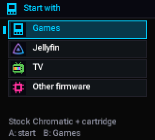
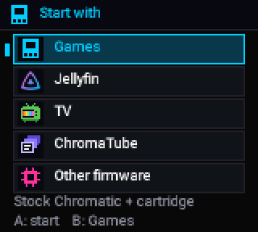
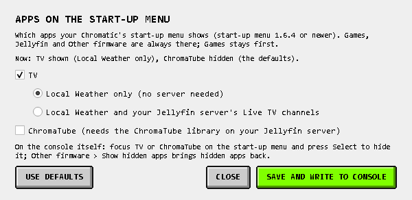
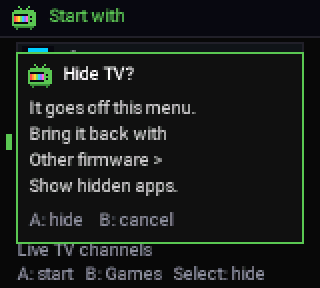
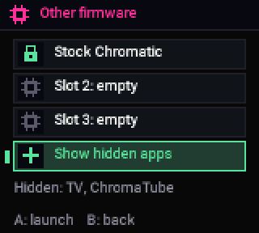

<!-- SPDX-License-Identifier: GPL-3.0-or-later -->
# Apps on the start-up menu

[Home](Home.md) › Apps on the start-up menu

**Contents:** [The rows](#the-rows) · [In Chromatic Manager](#in-chromatic-manager) · [On the console](#on-the-console) ·
[What each app needs](#what-each-app-needs) · [What stays the same](#what-stays-the-same)

## The rows

From start-up menu **1.6.5**, you choose which apps the menu shows. **Games** is always first, always selected when
you switch the console on, and **B** always means Games.

| Row | What it is | Shown |
|---|---|---|
| **Games** | Your cartridge, on the console's own untouched firmware | Always |
| **Jellyfin** | Browse and play your Jellyfin library ([Using Jellyfin](Using-Jellyfin-on-the-Chromatic.md)) | Always |
| **TV** | The retro **Local Weather** channel; optionally also your Jellyfin server's **Live TV** channels ([TV and Local Weather](TV-and-Local-Weather.md)) | On by default, with Local Weather only |
| **ChromaTube** | Optional video channels through your Jellyfin server ([ChromaTube](ChromaTube.md)) | Off by default |
| **Other firmware** | The stock firmware, listed and protected; and **Show hidden apps** when an app is hidden | Always |

So a new console shows four rows: **Games, Jellyfin, TV, Other firmware**, and TV opens straight to Local Weather,
which needs only Wi-Fi.

TV and ChromaTube are separate apps with their own guides and server tools
([Chromavision](https://github.com/ChaoticSPARTAN1/Chromavision) and [ChromaTube](https://github.com/ChaoticSPARTAN1/ChromaTube)),
built into the same start-up menu: there is still one start-up menu to install, check and undo.

## In Chromatic Manager

**Settings › Apps** (text menu: `a`):

- **TV**: on or off. When on, choose **Local Weather only** (no server needed) or **Local Weather and your Jellyfin
  server's Live TV channels** (only once your server has Live TV channels: [TV and Local Weather](TV-and-Local-Weather.md#live-tv-optional)).
- **ChromaTube**: on or off (useful once your server has the ChromaTube library: [ChromaTube](ChromaTube.md#set-it-up)).

Press **Save and write to console**, plug the console in, switch it on and press **Approve**. Only the small apps
record is written and checked on the chip; a game that is playing stops; your Wi-Fi, Jellyfin sign-in, weather
location and games stay as they are. **Use defaults** goes back to "TV with Local Weather only, ChromaTube off".

The choice survives updates of the start-up menu and Switch menu off. If the console ever loses it (after Remove menu
or Restore original), the next install puts back the copy Chromatic Manager kept on your PC.

## On the console

- **Hide an app:** on the start-up menu, move to **TV** or **ChromaTube** and press **Select**. The console asks
  "Hide TV?": **A** hides it, **B** cancels. (On Games, Jellyfin and Other firmware, Select still shows the Credits.)
- **Bring hidden apps back:** choose **Other firmware**, then **Show hidden apps** (the row is there whenever an app is
  hidden), and press **A** on the question.
- These questions answer only to the console's own buttons, not to remote-control tools such as Remote Pilot. If the
  console says **Could not save**, nothing changed on the menu: try again, or use Chromatic Manager.

## What each app needs

| App | Needs | Set up with |
|---|---|---|
| Jellyfin | Wi-Fi, your Jellyfin server, a Quick Connect sign-in | [First run on the console](First-run-on-the-console.md) |
| TV: Local Weather | Wi-Fi with internet (no Jellyfin server, no sign-in); a US place | Settings › Weather location (until then: Orlando, FL) |
| TV: Live TV channels | One Live TV tuner on your Jellyfin server; Live TV allowed for the console's user | Settings › Live TV channels, or [Chromavision](https://github.com/ChaoticSPARTAN1/Chromavision)'s PC tools |
| ChromaTube | A small server tool beside Jellyfin and one library named "ChromaTube" | Settings › ChromaTube server, or [ChromaTube](https://github.com/ChaoticSPARTAN1/ChromaTube)'s files and tool |

Sound in every app needs the console chip image 18.40 or 18.41
([Install](Install-with-Chromatic-Manager.md#jellyfin-sound-fpga-1840)).

## What stays the same

- The official firmware, your games, saves, cartridges and flash carts are never touched by any app.
- Holding a button while switching on still skips the menu; any restart that is not a power-on still goes straight
  to Games.
- No app needs a new sign-in on the console: TV's Live TV and ChromaTube use the console's existing Jellyfin sign-in;
  Local Weather needs none.
- The Pocket link is still offered from the Jellyfin row only; TV and ChromaTube are on the Chromatic only.
- The apps record holds nothing personal.

Next: [TV and Local Weather](TV-and-Local-Weather.md)
