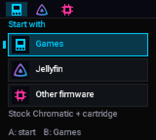
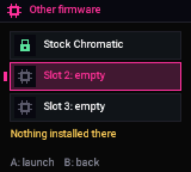

<!-- SPDX-License-Identifier: GPL-3.0-or-later -->
# Before you start: keeping your games working

[Home](Home.md) › Before you start

**Contents:** [How the start-up menu works](#how-the-start-up-menu-works) ·
[Games is always there](#games-is-always-there) · [What is changed on the console](#what-is-changed-on-the-console) ·
[What is never changed](#what-is-never-changed) · [If something fails](#if-something-fails)

## How the start-up menu works

The Chromatic has two chips: an **ESP32** (menus, Wi-Fi, settings) and an **FPGA** (the game hardware itself).
Jellymatic adds a small **start-up menu** to the ESP32, **next to** the official firmware, not instead of it.

When you switch the console on, a tiny boot program makes one decision:

| How the console started | What runs |
|---|---|
| You switched it on | The start-up menu (if its image checks out; otherwise the official firmware) |
| Anything else: a restart, a crash, a watchdog | The official firmware, directly |
| You held any button while switching on | The official firmware, directly, no menu |

There is no setting, flag or saved state that could go wrong: the reason for the start is the only input.

## Games is always there

- **Games** (or **B** on the menu) restarts the console into its own firmware and your cartridge. It is
  the same as before Jellymatic, with your settings, palettes and saves.
- **Other firmware** lists the stock Chromatic first, marked "Protected, always here".
- The menu waits for your choice; nothing starts by itself, and nothing is lost by leaving it open.
- Cartridges, flash carts, their SD cards and saves are never read or written by Jellymatic.

## What is changed on the console

Only three areas of the ESP32's flash:

| Area | What |
|---|---|
| Boot program (`0x1000`) | A small custom bootloader built from Espressif's ESP-IDF 5.3 |
| Partition table (`0x8000`) | The three official rows, unchanged and in order, plus one row for the menu |
| Menu area (`0x260000` onward) | The start-up menu and, at the very end, your Wi-Fi and Jellyfin set-up |

Optional, only if you choose Jellyfin sound or the Pocket link: the FPGA image is replaced by a version of
ModRetro's own open-source design with sound hooks (18.40) or with sound hooks and the Pocket link
bridge (18.41). It still plays every game; it reports itself with the same major version (18) so
ModRetro's tools still recognise the console.

## What is never changed

- The **official firmware** slot, your **settings** (NVS) and **radio calibration** (PHY data).
- The cartridge, its saves, and any flash cart.

## If something fails

Every change is made by Chromatic Manager, and every write:

1. starts from a **backup** of the console (the first time: both chips, each read twice), saved with a second copy on your PC (put that copy on another disk or a USB stick if you can);
2. is **written down in a journal** before it happens, so an interrupted job can be finished or undone;
3. is **read back** and compared byte for byte, then the whole flash is checked;
4. needs **your Approve** in the Manager's window (an AI assistant can ask, but you decide);
5. ends with a **start check**: the console must start and keep running.

The ESP32 also has a recovery mode in its read-only ROM that no flash content can block, so the Manager
(or ModRetro's official updater) can always reach it again. See [Recovery](Recovery.md).

Next: [Install with Chromatic Manager](Install-with-Chromatic-Manager.md)
