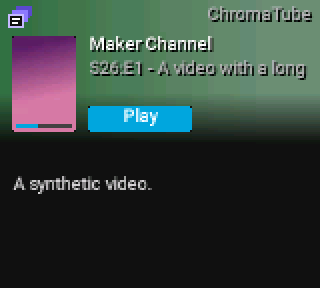
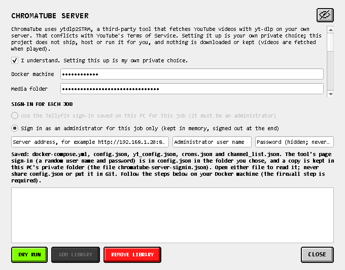
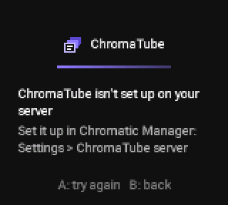

<!-- SPDX-License-Identifier: GPL-3.0-or-later -->
# ChromaTube

[Home](Home.md) › ChromaTube

**Contents:** [What it is](#what-it-is) · [Before you set it up](#before-you-set-it-up) · [Set it up](#set-it-up) ·
[Using it](#using-it) · [Undo](#undo)

## What it is

The optional **ChromaTube** row is the app [ChromaTube](https://github.com/ChaoticSPARTAN1/ChromaTube), built into the
start-up menu and **off until you switch it on**: the newest videos of the channels you choose, played through your own
Jellyfin server. A small third-party tool beside Jellyfin lists those videos as one Jellyfin library named "ChromaTube";
nothing is downloaded ahead or kept, and the server converts the one video you play into the console's small format,
like a film.

**ChromaTube is unofficial: it is not made, affiliated with or endorsed by YouTube or Google.** YouTube is a trademark
of Google LLC.

## Before you set it up

The server tool ChromaTube uses, **ytdlp2STRM** (it fetches videos with yt-dlp), **conflicts with YouTube's Terms of
Service**. Setting it up is **your own private choice**; this project does not ship, host or run it for you. Nothing
else on the start-up menu needs it. Read
[ChromaTube: Before you start](https://github.com/ChaoticSPARTAN1/ChromaTube/blob/main/docs/Before-you-start.md).

## Set it up

**In Chromatic Manager:** **Settings › ChromaTube server** (text menu: `y`); tick "I understand" first.

1. Fill in your Docker machine's home-network address, a **media folder** on that machine that your Jellyfin container
   can already see (but **not** inside one of your library folders: then Jellyfin needs no restart and no new mount),
   the folder where you keep the settings files, and your channels (one a line, like `https://www.youtube.com/@name`).
2. **Save files...** writes `docker-compose.yml` and four settings files into a folder you choose on your PC.
   `config.json` gets the tool's **page sign-in**, which is **required**: a random user name and password that Chromatic
   Manager makes for you. It is stored only in `config.json` and in a private copy on your PC (Chromatic Manager's file
   `chromatube-server-signin.json`); the window never shows it (open either file if you need to read it). Saving again
   keeps the same sign-in. Never share `config.json` or put it in Git. Copy the five files to the settings folder on the
   Docker machine.
3. **Required:** on the Docker machine's firewall, allow port **5005** only from your Jellyfin server; allow your PC
   only while you run **Check it answers** or open the tool's page, then remove that rule. Never forward 5005 on your
   router. The firewall is the real protection: the sign-in guards only the tool's settings pages.
4. In your Docker app, create a project named `chromatube` from `docker-compose.yml` (or run
   `docker compose -p chromatube up -d` in that folder). The Manager never runs Docker for you.
5. **Check it answers** (with the temporary firewall rule for your PC): it passes only when the tool's settings page
   **refuses** a visitor without the sign-in and **answers** with it (the private copy on your PC). If it says the tool
   answers without a sign-in, copy the saved `config.json` to the Docker machine again and restart the project. Then
   remove the firewall rule for your PC.
6. Sign in as an administrator for this job (a typed password is kept in memory only and signed out at the end; no
   other device is ever signed out), press **Find it** (or type the folder as Jellyfin sees it), **Dry run**, then
   **Add library** and **Approve**. One library named "ChromaTube" is added; your other libraries stay exactly as
   they were.
7. **Settings › Apps**: switch ChromaTube on.

**Keep it safe (required):** the tool's page can change its settings, so it **must have a sign-in**: both
`ytdlp2strm_web_username` and `ytdlp2strm_web_password` set in `config.json` (Chromatic Manager's Save files, or
ChromaTube's `make_server_config.py`, writes a random pair; keep the file private, never commit or share it). **What
the sign-in does not cover:** in the pinned version it protects the settings pages only. The tool's live command
channel (Socket.IO, used by its page to run its own command line) has no sign-in and accepts connections from any web
page, and it can start programs inside the container, so anything that can reach port 5005 (including a web page open
in a browser on an allowed computer) could use it. **The firewall rule is the real protection:** allow port **5005**
on that machine's firewall **only from your Jellyfin server**, with no port forwarding; allow your PC only while you run
Check it answers or open the page, then remove that rule. The image is pinned by its digest and never changes by
itself; ChromaTube's compose file mounts the settings read-only and allows no privilege escalation (if the tool cannot
read its settings, check the owner and permissions of `config.json` on the Docker machine); **no YouTube account or
cookies** are used. ChromaTube must not be used for paid, members-only or
DRM-protected videos. By hand, without the Manager: ChromaTube's
[Server set-up](https://github.com/ChaoticSPARTAN1/ChromaTube/blob/main/docs/Server-setup.md) and
[Add the library](https://github.com/ChaoticSPARTAN1/ChromaTube/blob/main/docs/Add-the-library.md); its tool and the
Manager recognise each other's library record.

## Using it

Start-up menu › **ChromaTube** › a channel › a video › **Play**. **B** goes back; at the channels it returns to the
start-up menu. Videos play as one stream from the beginning (no seeking or resume). If the server has no library named
exactly "ChromaTube", the row says **ChromaTube isn't set up on your server**.

**Select** on the start-up menu's
ChromaTube row asks "Hide ChromaTube?".

Open ChromaTube videos from the **ChromaTube** row: the library also shows in the Jellyfin row, but a ChromaTube video
opened there plays full size without sound.

## Undo

Settings › ChromaTube server › **Remove library** and Approve (the library only; its files are not touched). A library
this PC did not add is removed only when its folder is named ChromaTube and holds channel folders, after you confirm it
is yours. In your
Docker app, stop and delete the `chromatube` project; delete the settings folder and the ChromaTube media folder. Then
switch ChromaTube off in Settings › Apps. Your Jellyfin server is otherwise exactly as before
([ChromaTube: Undo everything](https://github.com/ChaoticSPARTAN1/ChromaTube/blob/main/docs/Undo-everything.md)).

Next: [Hosting Jellyfin](Hosting-Jellyfin.md)
