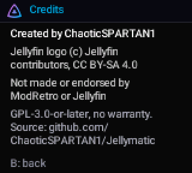

<!-- SPDX-License-Identifier: GPL-3.0-or-later -->
# Credits & licences

[Home](Home.md) › Credits & licences

**Contents:** [Author](#author) · [This project's licence](#this-projects-licence) · [Parts made by others](#parts-made-by-others) ·
[Used, not included](#used-not-included) · [Read as references](#read-as-references) · [Trademarks](#trademarks)

## Author

Created by **ChaoticSPARTAN1**. Under GPLv3 section 7(b), redistributions and modified versions must keep
this attribution in the README credits and in any About/credits screen ([ADDITIONAL-TERMS.md](../ADDITIONAL-TERMS.md)).
The start-up menu's credits screen and Chromatic Manager's About tab show it.

## This project's licence

**GPL-3.0-or-later** ([LICENSE](../LICENSE)), for everything written for Jellymatic: the start-up menu, the
Jellyfin app, the RTL in `rtl/` and `chromatic/fpga-media/`, Chromatic Manager, the scripts, Remote Pilot
and the documentation. [ADDITIONAL-TERMS.md](../ADDITIONAL-TERMS.md) adds the attribution term (7(b)), the
marking of modified versions (7(c)), and two additional permissions: for FPGA bitstreams that combine
Jellymatic's RTL with ModRetro's design and Gowin IP, and for linking the console firmware with
Espressif's binary-only Wi-Fi/PHY libraries and the ESP32 ROM.

## Parts made by others

| Part | Where | Licence | Notes |
|---|---|---|---|
| ModRetro Chromatic FPGA design v18.14, files modified by ChaoticSPARTAN1 for Jellymatic, 2026-11 | `fpga/images/*/src/` (the list is in [NOTICE](../NOTICE)) | GPL-3.0 | © ModRetro and contributors; the game core files (`gb.v` and others) come from the MiSTer handheld core "Gameboy_MiSTer" (GPL-3.0-or-later, Till Harbaum and the MiSTer developers). `uart.v` names Gowin (GaoYun Semi) as its creator; ModRetro publishes it under its repository's GPL. Only the changed files are here; the rest is ModRetro's public repository at the commit in `upstream.lock.json`. |
| Shiny Relay 1.1.5 parts | the `uart_tx_busy` fix in the 18.41 `system_monitor.sv`; the request-once status channel pattern in `rtl/chromatic_pocket_link.v`; the Wi-Fi join wording in `chromatic/launcher/shared/wifi_scan.h` | GPL-3.0 | © Shiny Gen. Marked in each file. |
| `speedcontrol.vhd`, Verilog translation for simulation | `chromatic/fpga-media/sim/speedcontrol_model.v` | GPL-3.0 (as the original; not under ADDITIONAL-TERMS.md) | From ModRetro's design, which has it from the MiSTer core "Gameboy_MiSTer"; translated by ChaoticSPARTAN1. |
| "Simple UART for FPGA", Verilog port for simulation | `rtl/uart2_vhdl_port.v` | MIT (the port: GPL-3.0-or-later) | © Jakub Cabal; the VHDL original is part of ModRetro's design. [LICENSES/MIT-uart_for_fpga.txt](../LICENSES/MIT-uart_for_fpga.txt) |
| ESP-IDF bootloader start file | `chromatic/launcher/bootloader_components/main/bootloader_start.c` | Apache-2.0 | © Espressif Systems; modified (the start decision). [LICENSES/Apache-2.0.txt](../LICENSES/Apache-2.0.txt) |
| Jellyfin logo, scaled | `chromatic/launcher/shared/launcher_art.h`, `scripts/chromatic_theme.py` (JELLYFIN_MARK), pictures in `docs/images/` showing it | CC BY-SA 4.0 | © the Jellyfin contributors, from jellyfin/jellyfin-ux. The scaled versions are shared under the same licence. [LICENSES/CC-BY-SA-4.0-Jellyfin-logo.txt](../LICENSES/CC-BY-SA-4.0-Jellyfin-logo.txt) |
| Roboto Medium, rasterized | `pocket/ui_font.h` (made by `scripts/build_ui_font.py`) | Apache-2.0 | Roboto 2.138 by Christian Robertson, Copyright 2011 Google Inc. [LICENSES/Apache-2.0.txt](../LICENSES/Apache-2.0.txt) |
| T80 CPU core, SameBoy-derived boot ROM | not here: in ModRetro's source, built into the FPGA images 18.40 and 18.41 | BSD-style; MIT | © Daniel Wallner; © Lior Halphon. Their notices go with the images: [LICENSES/BSD-style-T80.txt](../LICENSES/BSD-style-T80.txt), [LICENSES/MIT-SameBoy-boot-ROM.txt](../LICENSES/MIT-SameBoy-boot-ROM.txt) |
| Press Start 2P font | `scripts/chromatic_gui_fonts/`, `remote-pilot/fonts/` | SIL OFL 1.1 | CodeMan38. [LICENSES/OFL-1.1-PressStart2P.txt](../LICENSES/OFL-1.1-PressStart2P.txt) |
| Silkscreen font | `scripts/chromatic_gui_fonts/`, `remote-pilot/fonts/` | SIL OFL 1.1 | The Silkscreen Project Authors. [LICENSES/OFL-1.1-Silkscreen.txt](../LICENSES/OFL-1.1-Silkscreen.txt) |

## Used, not included

Installed by you, under their own licences:

| Tool | Licence |
|---|---|
| ESP-IDF v5.3 (Espressif) and its components (FreeRTOS, lwIP, Mbed TLS, newlib, Wi-Fi libraries) | Apache-2.0 and others; see ESP-IDF's `COPYRIGHT.rst`. A **built** start-up menu contains these and must ship their notices. |
| ModRetro's FPGA source (with the MiSTer core ("Gameboy_MiSTer"), T80 CPU, SameBoy-derived boot ROM, Gowin IP) | GPL-3.0 / GPL-3.0-or-later / BSD-style / MIT / Gowin's terms. A **built** FPGA image contains these and must ship their notices and source. |
| Gowin EDA | Gowin's licence (proprietary). Never included. |
| openFPGALoader | Apache-2.0 |
| Python, PySide6 / Qt | PSF licence; LGPL-3.0 |
| esptool, pyserial | GPL-2.0-or-later; BSD-3-Clause |
| ModRetro's official update tool | ModRetro's terms. Never included; download it from ModRetro. |

## Read as references

These were read to understand the console; no code was copied from them except the parts listed above:
ModRetro's Chromatic MCU source (GPL-3.0), **ChromatiX** by Enjoy-Digital and contributors (GPL-3.0 /
BSD-2-Clause), and **Shiny Relay** by Shiny Gen (GPL-3.0; besides the parts listed above, the "debug bit"
version scheme follows its approach). Thank you to all of them.

## Trademarks

ModRetro and Chromatic are trademarks of ModRetro, Inc. Jellyfin is a trademark of its owners. Analogue and
Pocket are trademarks of Analogue. They are used only to say what
Jellymatic works with. Jellymatic is an independent project, not affiliated with, endorsed or supported by
any of them.
