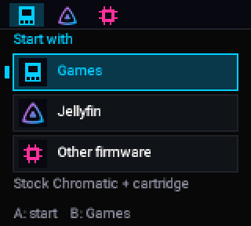
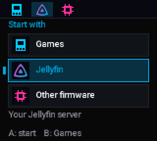
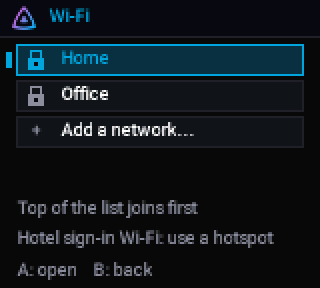
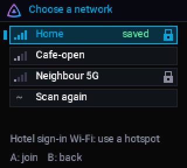
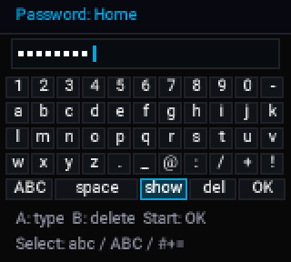
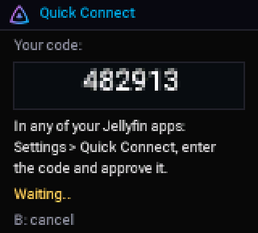

<!-- SPDX-License-Identifier: GPL-3.0-or-later -->
# First run on the console

[Home](Home.md) › First run on the console

**Contents:** [Open Jellyfin](#open-jellyfin) · [Add your Wi-Fi](#add-your-wi-fi) ·
[Sign in to Jellyfin](#sign-in-to-jellyfin-quick-connect) · [Pocket link](#pocket-link) · [Buttons](#buttons)

## Open Jellyfin

1. Put a cartridge in and switch the console **on**. The start-up menu appears.
2. Highlight **Jellyfin** with the D-pad and press **A**.
3. Press **Select** to open **Setup** (Wi-Fi networks / Jellyfin server).

## Add your Wi-Fi

1. **Setup › Wi-Fi networks › Add a network…** The console scans and lists networks nearby
   (strongest first; a lock means a password is needed).
2. Choose yours and type the password on the on-screen keyboard:
   D-pad to move, **A** types, **B** deletes, **Select** switches abc / ABC / #+=, **Start** is OK.
3. The console says **Saved**, then **Joining…**, then **Connected**, or the reason it could not join
   (wrong password, network not found…) in plain words.

Up to **4** networks are kept. Choose a saved one to **use it now**, **change its password** or **forget**
it. 2.4 GHz only; hotel-style sign-in pages are not supported (a phone hotspot works).

## Sign in to Jellyfin (Quick Connect)

1. **Setup › Jellyfin server › Find servers nearby** (or **Enter server address**, for example
   `http://your-server:8096`).
2. Choose your server. The console shows a **6-digit code**.
3. In any Jellyfin app where you are signed in (web, phone, TV): **Settings › Quick Connect**, enter the
   code, approve it.
4. The console says **Signed in**. It now has its own sign-in, shown in Jellyfin's
   **Dashboard › Devices** as "Chromatic". Your password never goes to the console.

Quick Connect must be on in the server's **Dashboard › General**. To undo: **Setup › Jellyfin server ›
Forget this sign-in** (it signs the console out on the server too), or revoke the device in Jellyfin.

## Pocket link

Only with the 18.41 console chip image installed ([Install](Install-with-Chromatic-Manager.md#update-the-pocket-link-in-one-step-fpga-1841))
and [PocketFin](https://github.com/ChaoticSPARTAN1/PocketFin) on the Pocket. See [Pocket link](Pocket-link.md).

## Buttons

| Where | Buttons |
|---|---|
| Start-up menu | D-pad choose · **A** start · **B** Games |
| Jellyfin page | **A** open the library · **Select** setup · **B** or **Start** back to the menu |
| Setup screens | D-pad · **A** open · **B** back |
| Holding any button while switching on | Skips the menu: straight to Games |

Next: [Using Jellyfin on the Chromatic](Using-Jellyfin-on-the-Chromatic.md)
