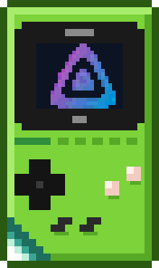
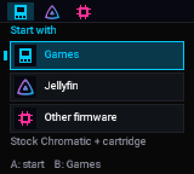

<!-- SPDX-License-Identifier: GPL-3.0-or-later -->
<p align="center"></p>
<p align="center"></p>

# Jellymatic wiki

**Jellyfin on your ModRetro Chromatic**, with a start-up menu that keeps your games exactly as they were.

> Jellymatic is an independent project, not affiliated with ModRetro or the Jellyfin project. Use it at
> your own risk; support is not guaranteed. "Jellyfin", "ModRetro" and "Chromatic" are trademarks of their
> owners, used only to say what this works with.

## Contents

| Page | Read it when |
|---|---|
| [What you need](What-you-need.md) | Before anything else: the console, the PC, the cable, the server |
| [Before you start](Before-you-start.md) | You want to know why your games keep working and what changes |
| [Install with Chromatic Manager](Install-with-Chromatic-Manager.md) | You are ready to install or update |
| [First run on the console](First-run-on-the-console.md) | Wi-Fi, Jellyfin sign-in, Pocket link set-up on the console |
| [Using Jellyfin on the Chromatic](Using-Jellyfin-on-the-Chromatic.md) | Browsing and playing |
| [Hosting Jellyfin](Hosting-Jellyfin.md) | Your server is not reachable over Wi-Fi yet |
| [Pocket link](Pocket-link.md) | You have an Analogue Pocket and a link cable |
| [Remote Pilot](Remote-Pilot.md) | You want to see and press the console's menus from the PC |
| [Recovery](Recovery.md) | Something went wrong, or you want to undo everything |
| [FAQ](FAQ.md) | Short answers |
| [Building from source](Building-from-source.md) | You want to build the start-up menu, the FPGA images or the Manager yourself |
| [AI prompt examples](AI-prompt-examples.md) | You use Claude, Codex or another assistant with the Manager |
| [Credits & licences](Credits-and-licences.md) | Who made what, and under which licence |
| [Design notes](Design-notes.md) | You read the code and meet a reference to an internal note |

## In one picture

```
 Switch on ──► start-up menu ──┬─► Games ............ the console's own firmware, untouched (always there)
                               ├─► Jellyfin ......... browse and play over Wi-Fi (Select: set-up)
                               │      └─► Pocket link  feed an Analogue Pocket over a link cable
                               └─► Other firmware ... the stock firmware, listed and protected
 Hold any button while switching on ──► straight to Games, no menu
```

<p align="center"></p>

The PC side is **Chromatic Manager**: one window with one main button at a time. It backs up the
console, installs or updates the start-up menu, reads every byte back, and can undo all of it.
