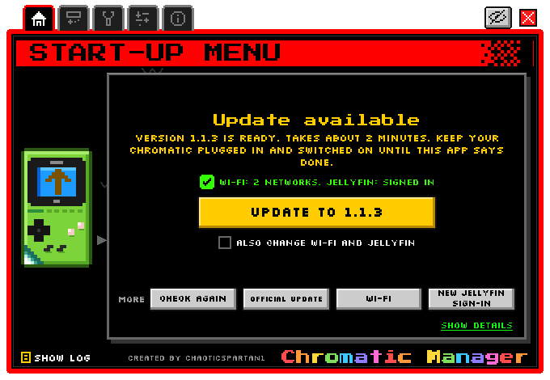
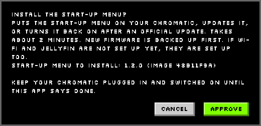
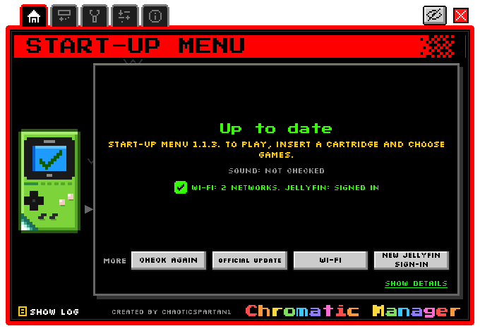
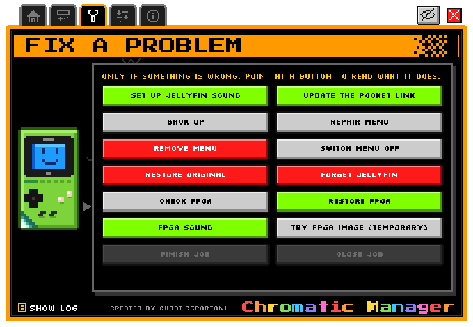
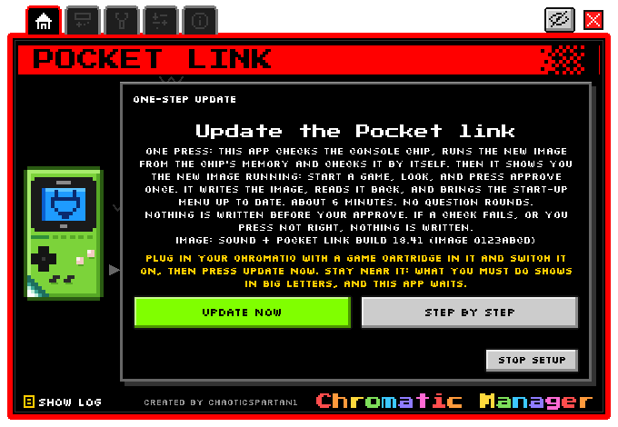

<!-- SPDX-License-Identifier: GPL-3.0-or-later -->
# Install with Chromatic Manager

[Home](Home.md) › Install with Chromatic Manager

**Contents:** [1. Set up the PC](#1-set-up-the-pc) · [2. Get the start-up menu image](#2-get-the-start-up-menu-image) ·
[3. Install](#3-install) · [The window](#the-window) · [Wi-Fi and Jellyfin from the PC](#wi-fi-and-jellyfin-from-the-pc-optional) ·
[Full backup before any FPGA change](#full-backup-before-any-fpga-change) · [Jellyfin sound](#jellyfin-sound-fpga-1840) ·
[Update the Pocket link](#update-the-pocket-link-in-one-step-fpga-1841) · [Text menu](#text-menu) · [Your files](#where-your-files-are)

## 1. Set up the PC

1. Install **Python 3.12+** from python.org (tick "Add python.exe to PATH").
2. Download this repository (Code › Download ZIP, or `git clone`) and unzip it, for example to `C:\Jellymatic`.
3. Right-click `Setup-Jellymatic.ps1` › **Run with PowerShell** (or
   `powershell -ExecutionPolicy Bypass -File Setup-Jellymatic.ps1`). It creates your private folder
   `%LOCALAPPDATA%\Jellymatic` and installs the three Python packages the Manager needs. It never
   touches a console and never uploads anything.

## 2. Get the start-up menu image

The Manager installs the three files in `release\launcher\` (`bootloader\bootloader.bin`,
`partition_table\partition-table.bin`, `chromatic_launcher.bin`). The easy way:

1. Open the [Releases page](https://github.com/ChaoticSPARTAN1/Jellymatic/releases/latest) (the latest
   Jellymatic release).
2. Download **`Jellymatic-start-up-menu-<version>.zip`**.
3. Extract it **into your Jellymatic folder** (the one with `Chromatic-Manager-Window.cmd`), keeping its
   folders: the three files land in `release\launcher\`, next to their licence notices and `SHA256SUMS`.

Or build them yourself with `scripts\Build-ChromaticLauncher.ps1`
([Building from source](Building-from-source.md#start-up-menu)).

## 3. Install

1. Plug the Chromatic into the PC with the USB cable and **switch it on**, with a cartridge in.
2. Double-click **`Chromatic-Manager-Window.cmd`**.
3. The Home tab checks the console (about 20 seconds; the first time, a full read takes about 6 minutes),
   then shows **one** main button. For a console without Jellymatic it is **Install**.
4. Press it, read the small **Approve** window (it names the exact image), press **Approve**.
5. The first time, the Manager takes the [full backup](#full-backup-before-any-fpga-change) of both chips
   (about 15 minutes, nothing written). Then it writes the menu, reads it back, checks the whole flash and
   restarts the console to watch it start. Keep the cable in and the console on until it says **Done**.
6. Switch the console off and on: the start-up menu appears. Carry on with
   [First run on the console](First-run-on-the-console.md).

Updating later is the same: extract the newer release zip the same way; when `release\launcher\` holds a
newer menu, Home shows **Update to x.y.z**.

## The window

| Tab | What is on it |
|---|---|
| **Home** | The console's state in plain words and at most one main button; under **More**: Check again, Official update, Wi-Fi, New Jellyfin sign-in |
| **Fix a problem** | Set up Jellyfin sound, Back up, Repair menu, Remove menu, Switch menu off, Restore original, Forget Jellyfin, the console chip (FPGA) jobs, Finish job, Close job (each button explains itself when you hover) |
| **Remote Pilot** | See and press the console's menus from the PC ([Remote Pilot](Remote-Pilot.md)) |
| **Settings** | AI control (off unless you allow it), Jellyfin on this PC |
| **About** | Folders, guide, licences |

The **eye** button at the top hides private details (addresses, network names, user names, IDs) on screen,
so screenshots are safe. It is on at every start.

## Wi-Fi and Jellyfin from the PC (optional)

You can set up everything on the console itself ([First run](First-run-on-the-console.md)). If you prefer
the PC: **More › Wi-Fi**. Networks come from `%LOCALAPPDATA%\Jellymatic\chromatic-wifi-networks.txt`
(optional; an `ssid=` line then a `password=` line per network, see `chromatic-wifi-networks.example.txt`)
or are typed in the window; they are **merged** with the networks
already on the console (at most 4). If this PC has Jellyfin settings (Settings tab), the console also gets
**its own** Jellyfin sign-in through Quick Connect: your password never goes to the console, and the
console appears as its own device in Jellyfin's Dashboard › Devices, where you can revoke it. Jellymatic
only ever signs out the console's own sign-in, never your other devices.

## Full backup before any FPGA change

Nothing is written to a console before a **full backup of both chips** exists on your PC. The first time
you press **Install** (or **Back up**, an official update, or any console chip job), the Manager takes it by
itself, before anything else, with no extra questions:

1. It checks the console model on the chips themselves (the ESP32, its flash chip, the console chip's
   JTAG id) and refuses a model or firmware it does not know.
2. It reads the whole **ESP32** flash (4 MiB) **twice**, every 256 KiB piece checked against the chip's
   own checksum, and the whole **console chip (FPGA)** flash (4 MiB) **twice** over its JTAG bridge
   (needs openFPGALoader, see [What you need](What-you-need.md)). The two reads of each chip must be
   identical, or nothing is kept. Both chips must be checked to belong to the same console.
3. The console must run the **official ModRetro firmware exactly as it comes**: no start-up menu (not
   even switched off), nothing half-installed, and none of Jellymatic's console chip images (sound
   18.40, Pocket link 18.41). Otherwise the backup is refused, because it would not be your original:
   put the official firmware back with ModRetro's own updater first
   ([Recovery](Recovery.md#official-updates-and-restoring-chromatic-os)).
4. It saves them in `%LOCALAPPDATA%\Jellymatic\chromatic-backup-<date>-<time>\`, makes the three-file
   restore bundle, copies it to the **second copy** folder, and reads every file back.
5. Only then does it record the backup as your console's original and go on.

This first full backup is taken **once**. An original that is already recorded is **never replaced**: if
it cannot be checked (for example the second copy's disk or USB stick is not connected), every job that
needs it stops and says so, and nothing is read or written. Connect the disk and try again.

This takes about 15 minutes and writes nothing to the console (the screen goes dark for a moment while
the console chip is read, then the console restarts). Your Wi-Fi passwords and Jellyfin sign-in are left
out of every backup.

**The second copy is usually on the same disk** (`%USERPROFILE%\Jellymatic-Backups`). For real safety
put it on another disk or a USB stick: set `JELLYMATIC_SECOND_COPY` to a folder there before the first
backup (for example `setx JELLYMATIC_SECOND_COPY "E:\Jellymatic-Backups"`, then open a new window).

Advanced, the same backup by hand (read-only tools, in a PowerShell window in the Jellymatic folder):
`scripts\chromatic_backup.py mcu`, then `scripts\chromatic_backup.py fpga --folder <the folder name it shows>`
(add `--second-copy "<another disk>"` to choose where the second copy goes). The second step also makes the
restore bundle and its second copy and checks both; only then is the backup recorded as your original. The
same rules apply as in the Manager: both steps refuse at once, before touching the console, when a full
backup is already recorded, and they need the start-up menu files in `release\launcher\` to recognise the
official firmware.

## Jellyfin sound (FPGA 18.40)

**Fix a problem › Set up Jellyfin sound** is a guided job: Check FPGA (reads all 4 MiB and recognises your
original image), a rehearsal that writes your original image back and checks it (so the undo is proven on
your console first), then the sound image, read back byte for byte. Needs the full backup above,
openFPGALoader, and the **official release files** `evt1_x2.fs` + `evt1_x2.bin` of the sound image in
`fpga\images\sound-18.40\build\`. Download **`Jellymatic-FPGA-images-<version>.zip`** from the
[Releases page](https://github.com/ChaoticSPARTAN1/Jellymatic/releases/latest) and extract it into your
Jellymatic folder, keeping its folders: it puts both images (18.40 and 18.41) in their `build\` folders
(see [What you need](What-you-need.md#for-jellyfin-sound-and-the-pocket-link)).

## Update the Pocket link in one step (FPGA 18.41)

**Update the Pocket link** (Home, when the console has the sound image and the reviewed 18.41 image is in
`fpga\images\link-18.41\build\`) is one screen with one button, **Update now**:

1. Check FPGA: the flash must be the sound image, byte for byte.
2. The new image is loaded into the chip's **RAM only**. Nothing is written yet.
3. Automatic checks: the image loaded, USB came back, the start-up menu reports FPGA 18.41.
4. **Your Approve, while the new image runs**: start a game for a moment and check picture and sound.
   *Not right*, Cancel or switching the console off writes nothing (an off-and-on returns to the old image).
5. The write, with backup checks, full read-back and journal; then a restart from flash that must report 18.41.
6. If the start-up menu is older than the one in `release\launcher\`, it is updated too (its own Approve).
   Then **Ready: plug in the cable**, with **Put the previous image back** one click away.

The Manager accepts only the reviewed 18.41 image: its `.fs`, `.bin` and stage receipt are pinned by
SHA-256 in `scripts/chromatic_fpga.py`. Any other build is refused, including your own build of the same
sources (it is almost never byte-identical), so use the official release files from
`Jellymatic-FPGA-images-<version>.zip` on the [Releases page](https://github.com/ChaoticSPARTAN1/Jellymatic/releases/latest).

## Text menu

`Chromatic-Manager.cmd` opens the same tool as a text menu: 1 status, 2 backup, 3 install, 4 remove,
5 restore-stock, 6 guided official update, 7 Wi-Fi setup, 8 Jellyfin re-link, 9 Jellyfin forget. Every
write asks you to type a one-time word shown on screen (for example `yes482`).

## Where your files are

| Folder | What |
|---|---|
| `%LOCALAPPDATA%\Jellymatic` | Everything personal: journals, backups, logs, settings, Wi-Fi list, Jellyfin settings |
| `%USERPROFILE%\Jellymatic-Backups` | The second copy of every backup. It is usually on the same disk as the first: set `JELLYMATIC_SECOND_COPY` to another disk or a USB stick for real safety |

Set `JELLYMATIC_HOME` to move the first one. None of it is ever part of the repository. Run
`python scripts\user_paths.py` to print the paths.

Next: [First run on the console](First-run-on-the-console.md)
