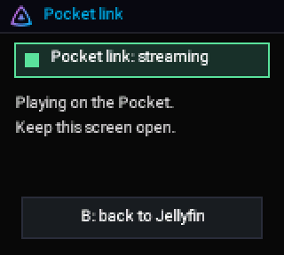
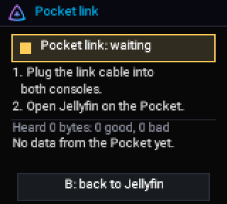

<!-- SPDX-License-Identifier: GPL-3.0-or-later -->
# Pocket link

[Home](Home.md) › Pocket link

**Contents:** [What it is](#what-it-is) · [What you need](#what-you-need) · [Set it up](#set-it-up) ·
[What the screen says](#what-the-screen-says) · [Undo](#undo) · [Limits](#limits)

## What it is

The Chromatic joins your Wi-Fi and Jellyfin; an **Analogue Pocket** plugged into it with a **link
cable** then browses your library and plays from it, through the Chromatic. The Pocket side is
[**PocketFin**](https://github.com/ChaoticSPARTAN1/PocketFin) (its own repository and instructions).

```
 Jellyfin server ──Wi-Fi──► Chromatic (start-up menu, FPGA 18.41) ──link cable──► Analogue Pocket (PocketFin)
```

## What you need

- The start-up menu installed and Jellyfin signed in on the Chromatic ([First run](First-run-on-the-console.md)).
- The console chip image **18.41** (sound + Pocket link) installed with
  [Update the Pocket link](Install-with-Chromatic-Manager.md#update-the-pocket-link-in-one-step-fpga-1841).
  18.41 is ModRetro's open-source FPGA design (v18.14) with sound hooks and a link bridge added; every
  game still plays as before.
- An Analogue Pocket with PocketFin installed, and a link cable.

## Set it up

1. On the Chromatic: start-up menu › **Jellyfin**, and stay on the Jellyfin page. With 18.41 the Pocket
   link starts there by itself and shows **Pocket link: waiting**.
2. Plug the link cable into both consoles.
3. On the Pocket: open PocketFin's Jellyfin core.
4. The Chromatic shows **Pocket link: connected**. Browse and play on the Pocket; keep the Chromatic on
   that screen.

<p align="center">
</p>

## What the screen says

| Light | Words | Means |
|---|---|---|
| Yellow | Pocket link: waiting | Plug the cable in, open Jellyfin on the Pocket |
| Green | Pocket link: connected | The Pocket can browse your library and play from here |
| Yellow | Syncing N of M | Copying pictures to the Pocket for offline browsing |
| Green | Pocket link: streaming | A video plays on the Pocket |
| Red | Pocket link: unplugged | No word from the Pocket for 9 seconds: plug the cable back in |
| Red | Pocket link: stopped | The link stopped (the reason is shown); it tries again by itself |
| Yellow | Pocket link: slow | The fast connection failed: browse and pictures only, no playing on this link |

**B** goes back to the Jellyfin page. **Games** on the start-up menu works as always; the link is only
active on the Jellyfin page.

## Undo

Chromatic Manager › **Put the previous image back** (the sound image 18.40), or **Fix a problem ›
Restore FPGA** (your own original FPGA image, from your full backup), or ModRetro's official update tool.
See [Recovery](Recovery.md).

## Limits

- Tested on the PC with simulators and on one console; your link cable and Pocket may behave differently.
- The link speed is limited by the cable: picture size and frame rate on the Pocket are small.

Next: [Remote Pilot](Remote-Pilot.md)
