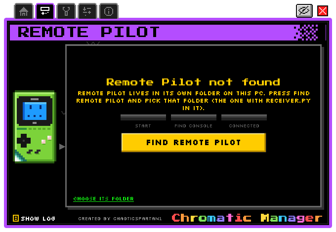
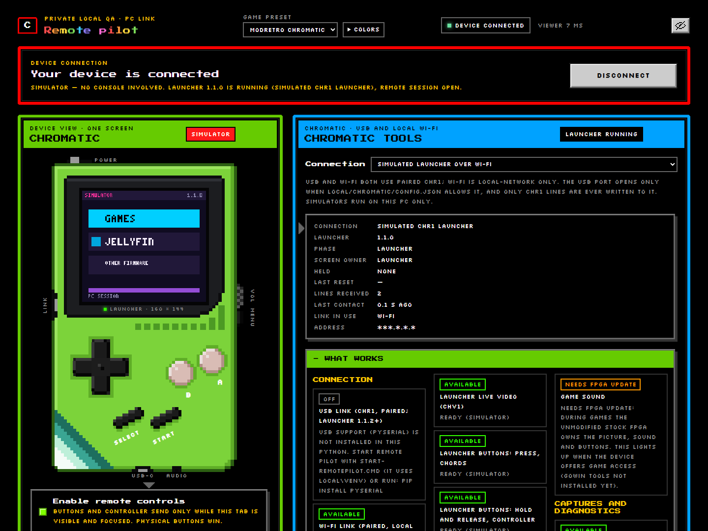

<!-- SPDX-License-Identifier: GPL-3.0-or-later -->
# Remote Pilot

[Home](Home.md) › Remote Pilot

**Contents:** [What it is](#what-it-is) · [Why it is bundled](#why-it-is-bundled) · [In Chromatic Manager](#in-chromatic-manager) ·
[In your browser](#in-your-browser-web-tool) · [Pairing](#pairing) · [For AI assistants](#for-ai-assistants-command-line) ·
[Safety](#safety) · [Full documentation](#full-documentation)

## What it is

[**Remote Pilot**](https://github.com/ChaoticSPARTAN1/RemotePilot) is a small program on your PC that
shows the Chromatic in your web browser: you **see its live screen, press its buttons, read its logs and
save screenshots**, over the USB cable or your home Wi-Fi. It works with the start-up menu and the
Jellyfin screens. It cannot change firmware; only Chromatic Manager does that.

The `remote-pilot/` folder is a copy of the
[RemotePilot](https://github.com/ChaoticSPARTAN1/RemotePilot) repository: its Chromatic web tool part (the
receiver, the web viewer, the Chromatic package and the **ModRetro Chromatic** and **Example** presets).

## Why it is bundled

- **Easier set-up and troubleshooting**: read the console's menus and messages on your PC screen instead
  of squinting at the handheld, and click its buttons.
- **Clean bug reports**: screenshots and logs with addresses, network names and codes masked.
- **AI assistants, safely**: Claude, Codex or another assistant can test or demo the console through
  Remote Pilot's command line; it presses buttons and reads the screen, nothing more.
- **Remote demos**: show the console's screens to someone else from your PC.

It is **optional**, works **only on your own PC and private network** by default, and is **never needed**
to watch Jellyfin.

## In Chromatic Manager

Open the **Remote Pilot** tab. The Manager finds the bundled `remote-pilot\` folder (or the folder in
`REMOTE_PILOT_HOME`), starts its receiver with Remote Pilot's own Python (`remote-pilot\local\venv`, made
by `Setup-Jellymatic.ps1`), and opens the Chromatic page in a window. While a Manager job runs, Remote
Pilot lets go of the USB port, and gets it back afterwards.

<p align="center"></p>

## In your browser (web tool)

1. Double-click `remote-pilot\Start-RemotePilot.cmd`.
2. Open `http://127.0.0.1:38764/` and choose **ModRetro Chromatic** in the **Game preset** menu.
3. Press **Connect to device**. The first time, it lists the console's USB port and offers **Allow USB on
   COMx**; only that click writes Remote Pilot's private settings (`remote-pilot\local\`, never in Git).

To try it without a console, choose a **Simulated** connection in the Chromatic tools panel.

<p align="center"></p>

## Pairing

- **Pair over USB**: both screens show the same 6-digit code; only an **A** press on the console approves.
- Or let Chromatic Manager's Wi-Fi setup provision a pairing key (it writes the console and
  `remote-pilot\local\chromatic\pairing.json` together).
- Wi-Fi control works only on your private network. A Wi-Fi pairing code expires after 10 minutes, works
  once, and is replaced after 20 wrong tries. Viewers on other PCs of your network can watch, but cannot
  change the mode, pair, or run Manager actions.

## Running Chromatic Manager from Remote Pilot (optional, off by default)

Remote Pilot's **Firmware patching** panel can start Chromatic Manager jobs, but only after you switch it
on yourself in `remote-pilot\local\chromatic\config.json`:

```json
{"managerProject": "C:\\path\\to\\Jellymatic", "managerRunAllowed": true,
 "managerPython": "C:\\path\\to\\LocalAppData\\Jellymatic\\venv\\Scripts\\python.exe"}
```

Set `managerPython` to the Python that `Setup-Jellymatic.ps1` made (the full path of
`%LOCALAPPDATA%\Jellymatic\venv\Scripts\python.exe`). Every write still asks for your confirmation.
Easier and recommended: use Chromatic Manager's own window.

Details: [Pairing with a Chromatic](../remote-pilot/docs/Pairing-with-a-Chromatic.md).

## For AI assistants (command line)

Start Remote Pilot and connect first, then (from the `remote-pilot` folder):

```powershell
local\venv\Scripts\python.exe -m chromatic.cli status          # what is connected, launcher version
local\venv\Scripts\python.exe -m chromatic.cli press DOWN      # one short press (or a chord: press A B)
local\venv\Scripts\python.exe -m chromatic.cli shot --png      # a screenshot; prints its path
local\venv\Scripts\python.exe -m chromatic.cli tail --lines 20 # newest console log lines
```

Every command talks only to the Remote Pilot on this PC (127.0.0.1). More, with example prompts:
[Using it with AI assistants](../remote-pilot/docs/Using-with-AI-assistants.md) and
[AI prompt examples](AI-prompt-examples.md).

## Safety

- Password fields on the console never show their text while Remote Pilot is connected.
- Remote Pilot never writes flash, never puts the console into firmware-update mode, and never takes the
  port while Chromatic Manager or ModRetro's updater works.
- Screenshots can show network names: check before you share them.

## Full documentation

The public repository [**RemotePilot**](https://github.com/ChaoticSPARTAN1/RemotePilot) has the
full wiki (also bundled in [`remote-pilot/docs/`](../remote-pilot/docs/Home.md)): what it does, install,
pairing, the web viewer, AI assistants, security model, troubleshooting and FAQ.

Next: [Recovery](Recovery.md)
