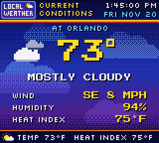
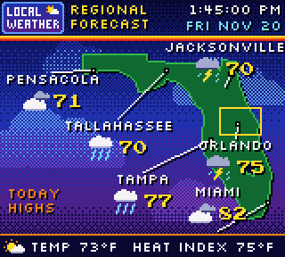
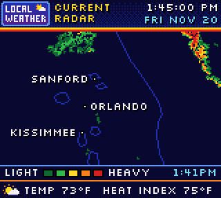
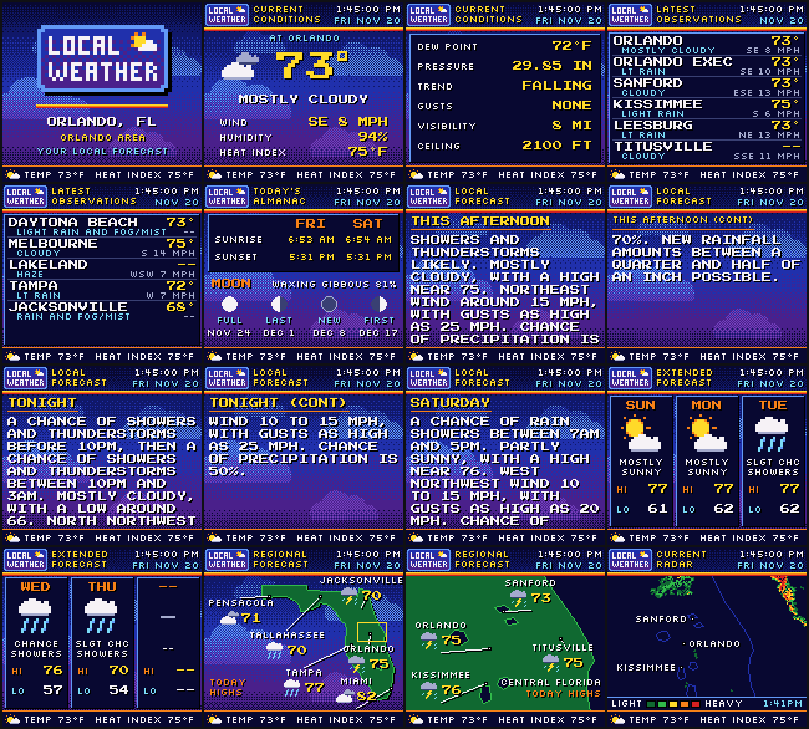
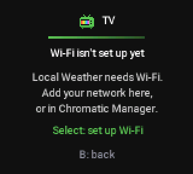
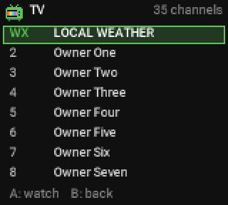
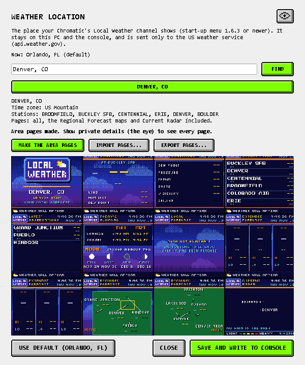
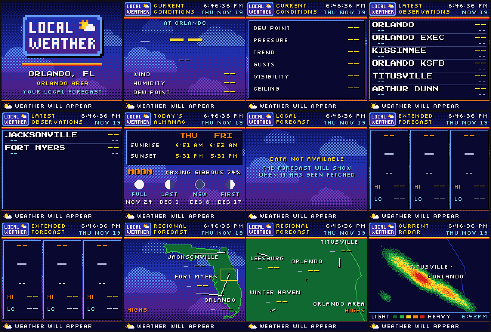
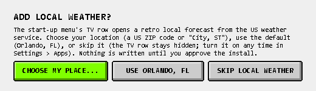
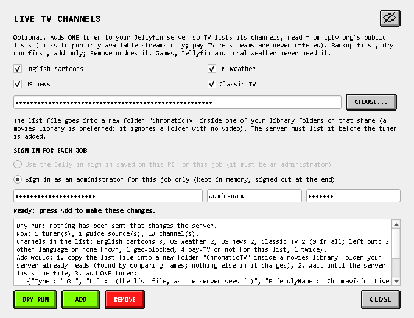

<!-- SPDX-License-Identifier: GPL-3.0-or-later -->
# TV and Local Weather

[Home](Home.md) › TV and Local Weather

**Contents:** [Local Weather](#local-weather) · [Your weather location](#your-weather-location) ·
[Location packs](#your-areas-map-and-radar-pages-a-location-pack) · [Live TV (optional)](#live-tv-optional) ·
[Buttons](#buttons) · [Privacy](#privacy) · [Limits](#limits)

The **TV** row is the app [Chromavision](https://github.com/ChaoticSPARTAN1/Chromavision), built into the start-up menu.
Its full guide, and PC tools for setting up live channels by hand, are in that repository.

## Local Weather

**Local Weather** is an early-1990s cable-style local forecast loop drawn by the console itself: current conditions,
latest observations, almanac (sun and moon), local and extended forecast, and a rain outlook (or radar), with music
and an announcer, from free US National Weather Service data. It needs Wi-Fi with internet access, **not** your
Jellyfin server and no sign-in.

- **TV with Local Weather only** (the default): start-up menu › **TV** opens **straight to Local Weather** once Wi-Fi
  has joined. **B** returns to the start-up menu.
- **TV with Live TV channels** (see below): TV opens a channel list with **WX LOCAL WEATHER** as its first row.

Every page of one loop for the built-in example place, Orlando, FL (drawn by the project's preview renderer from a
recorded set of weather replies):

Without Wi-Fi, TV says **Wi-Fi isn't set up yet** and **Select** sets it up right there:

> For fun only: **never use it for safety decisions**; follow official warnings.

## Your weather location

Until you choose a place, Local Weather shows the built-in default: **Orlando, FL**. To show your own:
Chromatic Manager › **Settings › Weather location** (text menu: `w`):

1. Type a US ZIP code or "City, ST" (for example `32801` or `Orlando, FL`) and press **Find**. The match comes from a table on your PC (US Census Bureau
   Gazetteer, public domain): nothing is sent yet.
2. Choose the place. The Manager asks the National Weather Service (the only service your place is sent to) for its
   forecast area, time zone and six nearest weather stations, and shows them.
3. **Save and write to console**, then **Approve**. Two small records of their own on the console hold the place;
   your Wi-Fi and Jellyfin set-up are not touched. The whole flash is checked on the chip.

**Use default (Orlando, FL)** erases your place (and its area pages) again. Installing, updating, downgrading or switching off the start-up
menu keeps the place; **Remove menu** and **Restore original** erase it. If the console lost the place (for example
after a removal), the next install writes the PC's saved copy back in the same job.

### Your area's map and radar pages: a location pack

On its own, a place gets its conditions, forecasts, almanac and nearby stations, with a **Rain Outlook** page where
the map and radar pages would be (a place in Florida keeps the built-in Florida map pages, and the radar near
Orlando). For your own area's maps and radar, add its **area pages**, a "location pack" (start-up menu 1.6.5 or
newer):

1. In **Settings › Weather location**, after choosing your place, press **Make the area pages**. Chromatic Manager asks
   the National Weather Service about the towns near your place (about a minute; for the chosen area only) and makes a
   small pack (a few KB) with:
   - **Regional Forecast**: your state's outline with today's highs for your place and up to five larger towns;
   - a **close-up** of your area with nearby towns;
   - **Current Radar**: the nearest weather service radar, around your place, with town labels.
2. A preview of every weather page, drawn by the console's own drawing code, appears in the window (hidden while
   private details are hidden; the figures show `--` until the console fetches them).
3. **Save and write to console**, then **Approve**: the place and its pages are written together and checked. They
   stay through updates of the start-up menu; **Use default (Orlando, FL)** removes both.

The pages a pack gives Orlando, FL (the built-in place, made here by the tool as an example; the figures appear when
the console fetches them):

**Sharing pack files.** **Export pages...** saves the pack as a `.pjlp` file; **Import pages...** uses one, for the same
place only. A pack file names its place: share it only if you want to. Chromatic Manager and the console check every
pack in full and ignore a damaged one (the console then shows the place without the map and radar pages), but **only
import packs from people you trust**. Without the window: `py -3 scripts\make_location_pack.py "Orlando, FL" orlando.pjlp`
makes the same file (Python 3 and a connection to the US weather service only).

The map pages are made by a program, not drawn by hand, so a crowded state can show fewer towns than Orlando's built-in
pages; town names and state outlines come from US Census Bureau data bundled with Jellymatic (public domain).

### The first install asks

When Chromatic Manager installs the start-up menu on a console for the first time, it asks **Add Local Weather?**
before the install's **Approve**: **Choose my place...** (a ZIP code or "City, ST", then it offers to make the area
pages), **Use Orlando, FL**, or **Skip Local Weather** (the TV row stays hidden; turn it on any time in Settings ›
Apps). Your answer is written by that same install, which says what it will write first. Updates do not ask again.

## Live TV (optional)

Your Jellyfin server's built-in Live TV can add live channels: one tuner reads a channel list built from public
iptv-org lists (free channels only; pay-TV re-streams are never included), and your server converts the channel you
watch into the console's small format. Nothing is installed on the console.

**In Chromatic Manager:** **Settings › Live TV channels** (text menu: `l`):

1. Tick the channel groups you want (English cartoons, US weather, US news, classic TV).
2. **Choose...** the folder on your PC that holds your Jellyfin library folders (for example a network share).
3. Sign in for this job: the saved sign-in (only if it is an administrator and you tick it), or type an administrator's
   name and password. A typed password is kept only in memory and that sign-in is signed out at the end of the job.
   No other device or session is ever signed out.
4. **Dry run** only reads: it shows how many channels, which library folder the list file would go into (a new
   folder "ChromaticTV") and the exact tuner that would be added.
5. **Add** and **Approve**: a backup of your Live TV settings first; the list file is copied; the tuner is added only
   once the server can see the file; then a check that nothing else changed.
6. **Settings › Apps**: choose "Local Weather and your Jellyfin server's Live TV channels".

The tuner is named "Chromavision Live TV (added by Chromavision tools)" and allows at most 2 channels at once. The
channels also show under Live TV in your other Jellyfin apps. Chromavision's PC tools can do the same by hand, with
your own choice of channels, and recognise a tuner the Manager added (and the reverse)
([Chromavision: Live TV set-up](https://github.com/ChaoticSPARTAN1/Chromavision/blob/main/docs/Live-TV-setup.md)).

**Undo:** Settings › Live TV channels › **Remove** and Approve. It deletes exactly that tuner and the list file it
wrote, and compares your Live TV settings with the backup. Then choose "Local Weather only" in Apps.

## Buttons

| Where | Buttons |
|---|---|
| Local Weather | Pages turn by themselves · **B** back (to the start-up menu, or to the channel list with Live TV) · with Live TV: **Up/Down** to the first/last channel |
| Channel list (with Live TV) | **Up/Down** move · **A** watch · **B** back to the start-up menu |
| Watching a channel | **Up/Down** next/previous channel (it tunes 1.5 s after your last press) · **A**, **Start** or **Select** show the channel name · **B** back to the list |
| Start-up menu, TV focused | **Select** asks "Hide TV?" ([Apps](Apps-on-the-start-up-menu.md#on-the-console)) |

A channel can show **No signal** (it refused, ended, or sent no picture for 20 s): free channels come and go. Every
way out closes the stream on the server. If Local Weather cannot open, the TV screen says **Local Weather did not
open** with the reason; **B** returns.

## Privacy

Your weather location stays on your PC and your console and is sent only to the National Weather Service: making
area pages asks it about the chosen area only (and checks one radar picture on its map server). The place look-up and
the maps use US Census Bureau data bundled with Jellymatic, so nothing else is asked. The console's clock also asks a
public time service (pool.ntp.org) for the time; it sends no location. Chromatic
Manager's status and logs say "your location", never the place. TV writes no watch history. Nothing about what you
watch is sent anywhere else.

## Limits

- Local Weather covers US places only. The radar page and the regional maps come from the built-in Orlando area or from
  your place's location pack; for a place without a pack a Rain Outlook page takes their place.
- One live channel at a time; no programme guide yet; no pause or rewind on live channels.
- Sound needs the console chip image 18.40 or 18.41.
- Not on the Analogue Pocket.

Next: [ChromaTube](ChromaTube.md)
