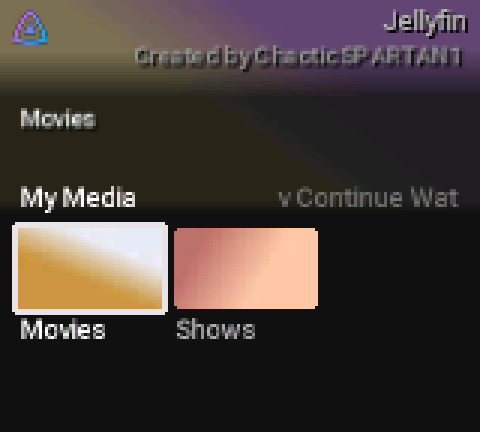
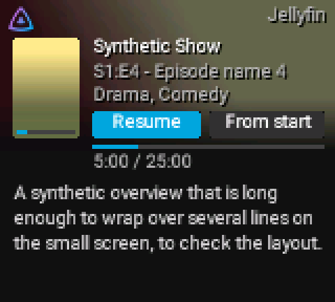
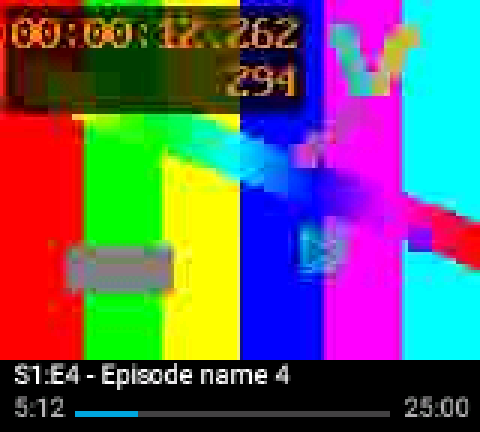
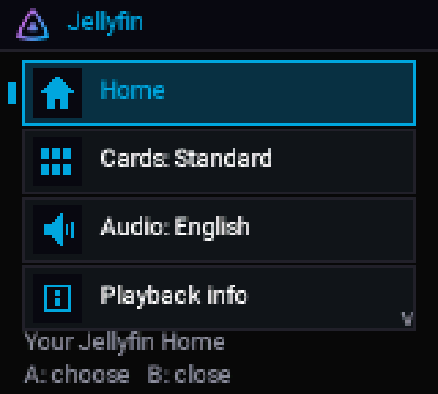

<!-- SPDX-License-Identifier: GPL-3.0-or-later -->
# Using Jellyfin on the Chromatic

[Home](Home.md) › Using Jellyfin on the Chromatic

**Contents:** [Browsing](#browsing) · [Playing](#playing) · [Sound](#sound) · [Slow Wi-Fi](#slow-wi-fi) ·
[Leaving](#leaving) · [Limits](#limits)

## Browsing

Open **Jellyfin** from the start-up menu. The console joins your saved Wi-Fi by itself and talks straight
to your Jellyfin server; no PC is needed.

- **Home**: rows in Jellyfin's own order (My Media, Continue Watching, Next Up, Latest per library).
- **Folders**: grids of posters or episode pictures.
- **Details**: **Resume** or **From start**, how far you got, and the overview.

## Playing

| Button | Does |
|---|---|
| **A** | Pause / play |
| **Left / Right** | Back / forward 10 seconds |
| **Select** | Show or hide the bar under the picture |
| **B** | Stop |

The app's menu has **Home**, the card size, the **audio track** (when a title has more than one) and
**Playback info**.

The server converts each title to a size the console can show (up to 160 × 120), at the title's own frame
rate. Pictures that are late are skipped rather than shown out of time. Where you stopped and what you
watched go back to the server, so other Jellyfin apps continue from the same place.

## Sound

Sound needs the console chip (FPGA) sound image 18.40 or the Pocket link image 18.41
([Install](Install-with-Chromatic-Manager.md#jellyfin-sound-fpga-1840)). With the official FPGA image, video
plays without sound and the console says so.

## Slow Wi-Fi

The player starts at about 1 Mbit/s and up to 15 pictures a second. If the network falls behind it halves the
bitrate (down to 200 kbit/s); if the console falls behind it asks for fewer pictures a second. The message
"Adjusting quality" shows when it does. Smooth play earns the quality back next time.

## Leaving

**B** stops playback; **B** again goes back through the screens; **Start** on the Jellyfin page returns to
the start-up menu, where **Games** starts your cartridge.

## Limits

- A cartridge must be in the console (the app draws over it).
- 2.4 GHz Wi-Fi only; no hotel sign-in pages.
- Subtitles and search are not available yet.

Next: [Hosting Jellyfin](Hosting-Jellyfin.md) · [Pocket link](Pocket-link.md)
