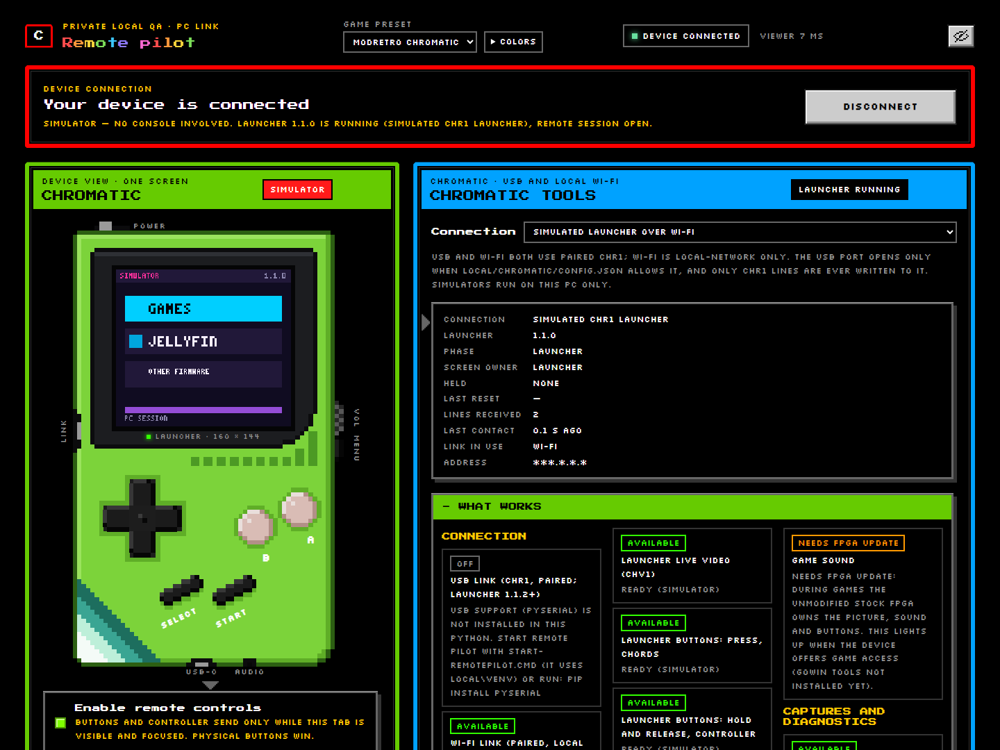

# Remote Pilot (web viewer for the ModRetro Chromatic)

Remote Pilot is a small program that runs on your Windows PC and shows a
**ModRetro Chromatic** handheld in your web browser. You can see its screen,
press its buttons, read its logs and save screenshots, over a USB cable or your
home Wi-Fi. It was made for testing: a person, or an AI test assistant such as
Claude or Codex, can drive the console from the PC while developing for it.

*Screenshot from the built-in simulator; no real console or network details are shown.*

## Quick start (Windows)

1. Install [Python](https://www.python.org/downloads/) 3.11 or newer (tick
   "Add python.exe to PATH" or use the `py` launcher).
2. Download this repository (<https://github.com/ChaoticSPARTAN1/RemotePilot>, green
   **Code** button, **Download ZIP**) and unzip it
   to a folder that is **not** synced by OneDrive or another cloud service (for
   example `C:\RemotePilot`): it will hold your console's pairing key.
3. Right-click `Setup-RemotePilot.ps1` and choose **Run with PowerShell**. It
   makes a private Python environment in `local\venv` with
   [pyserial](https://pypi.org/project/pyserial/) for USB. No admin rights are
   needed and nothing is uploaded.
4. Double-click `Start-RemotePilot.cmd` and open <http://127.0.0.1:38764/> in
   your browser.
5. Pick **ModRetro Chromatic** in the **Game preset** menu. To try it without a
   console, choose a **Simulated** connection in the Chromatic tools panel.

To use a real console it must run the Chromatic launcher from
[Jellymatic](https://github.com/ChaoticSPARTAN1/Jellymatic) (launcher 1.1.2 or
newer). See [Pairing with a Chromatic](docs/Pairing-with-a-Chromatic.md).

## Documentation

The [docs/](docs/Home.md) folder is a short wiki in plain English:

- [What it does](docs/What-it-does.md)
- [Install](docs/Install.md)
- [Pairing with a Chromatic over USB or Wi-Fi](docs/Pairing-with-a-Chromatic.md)
- [Using the web viewer](docs/Using-the-web-viewer.md)
- [Using it with AI assistants](docs/Using-with-AI-assistants.md)
- [Security model](docs/Security-model.md)
- [Troubleshooting](docs/Troubleshooting.md) and [FAQ](docs/FAQ.md)
- [Building from source and running the tests](docs/Building-from-source.md)
- [Credits and licences](docs/Credits-and-licences.md)

Developers adding another device: see [ADAPTER_API.md](ADAPTER_API.md).

## Related projects

- [Jellymatic](https://github.com/ChaoticSPARTAN1/Jellymatic): the Chromatic
  start-up launcher, Chromatic Manager (install, backup, restore) and the
  Jellyfin media app for the Chromatic.
- [PocketFin](https://github.com/ChaoticSPARTAN1/PocketFin): a Jellyfin client
  for the Analogue Pocket.

## Disclaimer

Remote Pilot is an independent hobby project. It is **not affiliated with,
endorsed by or supported by ModRetro**. "ModRetro" and "Chromatic" are
trademarks of their owners and are used here only to say which device the tool
works with. Jellyfin is a trademark of its owners; this project is not
affiliated with the Jellyfin project. Use it **at your own risk**: it can press
buttons on your console, and the optional Chromatic Manager tools can change
the console's firmware. Support is not guaranteed, but bug reports, bug fixes
and pull requests are welcome (see [CONTRIBUTING.md](CONTRIBUTING.md)).

## Licence

GNU General Public License, version 3 or (at your option) any later version:
see [LICENSE](LICENSE). Under GPLv3 section 7(b) you must keep the author
attribution "ChaoticSPARTAN1" in the credits and in the program's credit line;
see [ADDITIONAL-TERMS.md](ADDITIONAL-TERMS.md). Bundled fonts keep their own
licences: see [THIRD-PARTY-NOTICES.md](THIRD-PARTY-NOTICES.md).

## Credits

Created by **ChaoticSPARTAN1**. Pixel fonts: Press Start 2P (CodeMan38) and
Silkscreen (The Silkscreen Project Authors), both under the SIL Open Font
License 1.1. Full list: [Credits and licences](docs/Credits-and-licences.md).
