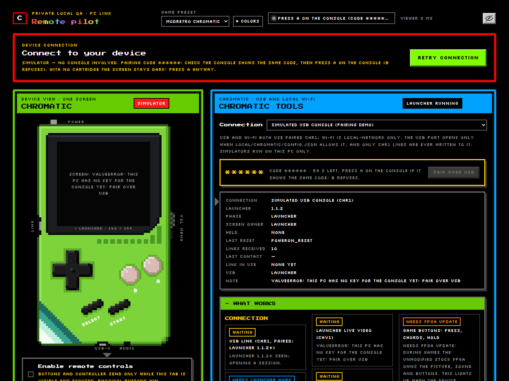
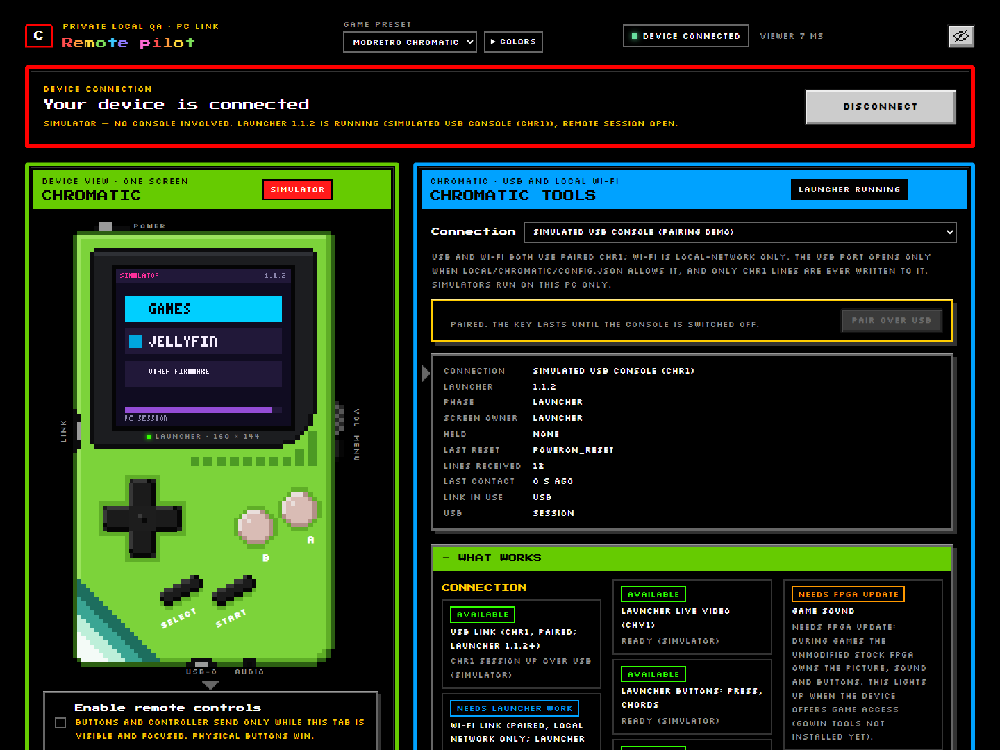

# Pairing with a Chromatic over USB or Wi-Fi

[Home](Home.md) › Pairing with a Chromatic

**On this page:** [What the console must run](#what-the-console-must-run) ·
[Try the simulator first](#try-the-simulator-first) · [Connect over USB](#connect-over-usb) ·
[Pair over USB](#pair-over-usb) · [Connect over Wi-Fi](#connect-over-wi-fi) ·
[Where the key is kept](#where-the-key-is-kept)

## What the console must run

Your Chromatic needs the **Chromatic launcher 1.1.2 or newer**, the start-up menu (Games /
Jellyfin / Other firmware) from **[Jellymatic](https://github.com/ChaoticSPARTAN1/Jellymatic)**.
Install it with Jellymatic's **Chromatic Manager**, which backs up your console first and can put
it back to stock at any time. The launcher always keeps **Games** (the console's own, untouched
firmware) available.

Older launchers, or a stock console, cannot be controlled. Remote Pilot can still show the
launcher's USB log lines read-only.

## Try the simulator first

In the **Chromatic tools** panel, set **Connection** to **Simulated launcher over Wi-Fi** or
**Simulated USB console (pairing demo)**. Nothing on your PC or network is touched; the simulator
runs inside Remote Pilot.

## Connect over USB

1. Plug the Chromatic into the PC with a USB-C data cable and switch it on.
2. Make sure the setup script installed pyserial (see [Install](Install.md)).
3. In the viewer pick **ModRetro Chromatic**, then press **Connect to device**.
4. Remote Pilot **lists** the console's USB port (it looks for the Chromatic's USB vendor ID) but
   does not open it. Click **Allow USB on COMx** under the button. Only this click, from this PC's
   own browser, saves the choice in `local\chromatic\config.json` and opens the port.
5. The launcher's countdown pauses while a session is open (at most 10 minutes per power-on).

If Chromatic Manager needs the USB port for a job, it asks Remote Pilot to let go of it; an amber
**USB paused** band shows until the job ends. Wi-Fi keeps working meanwhile.

## Pair over USB

The first USB session needs a pairing key:

1. Press **Pair over USB** in the panel (or run `python -m chromatic.cli pair-usb`).
2. The **same 6-digit code** appears on the console's screen and in the viewer (the viewer hides it
   as `******` while the privacy eye is on; click the eye to compare).
3. If the codes match, press **A on the console**. **B** refuses. Nothing is paired without that
   physical press.

After pairing, the session starts and the screen appears:

A USB-paired key lasts until the console is switched off. For a key that survives power-off, use
Chromatic Manager's *provisioning*, which writes the console's record and Remote Pilot's
`local\chromatic\pairing.json` together.

## Connect over Wi-Fi

1. Pair first (above), or provision a key with Chromatic Manager.
2. Set up Wi-Fi **on the console** (Jellymatic's launcher does this on the device).
3. On the console, open the launcher's **Jellyfin** screen and press **A**: the launcher joins
   Wi-Fi and shows its address.
4. In the viewer press **Connect to device**. Remote Pilot searches your private home network
   (the PC's own `/24` range) for the paired console and remembers the address it found. If your
   PC has more than one network, start it with `--pc-host <this PC's private address>`.

The Wi-Fi link only talks to private addresses (10.x, 172.16-31.x, 192.168.x) and every session
starts with a fresh challenge signed with the paired key.

## Where the key is kept

- `local\chromatic\pairing.json` inside the Remote Pilot folder. Git ignores the whole `local\`
  folder; never commit, upload or paste it.
- A key provisioned by Chromatic Manager is never silently replaced by a USB pairing; it is kept
  beside it as `pairing-provisioned.json`.
- To forget a key, delete that file (and remove the PC on the console, if your launcher offers it).

Next: [Using the web viewer](Using-the-web-viewer.md)
