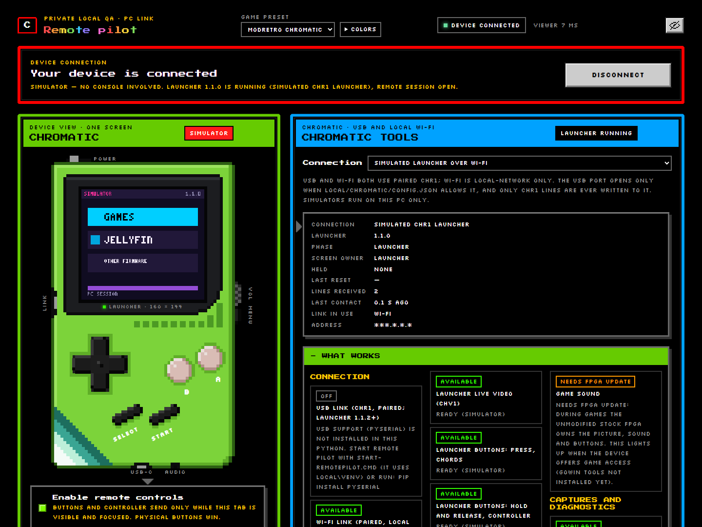
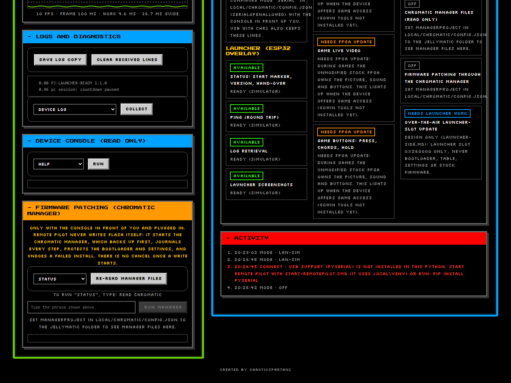
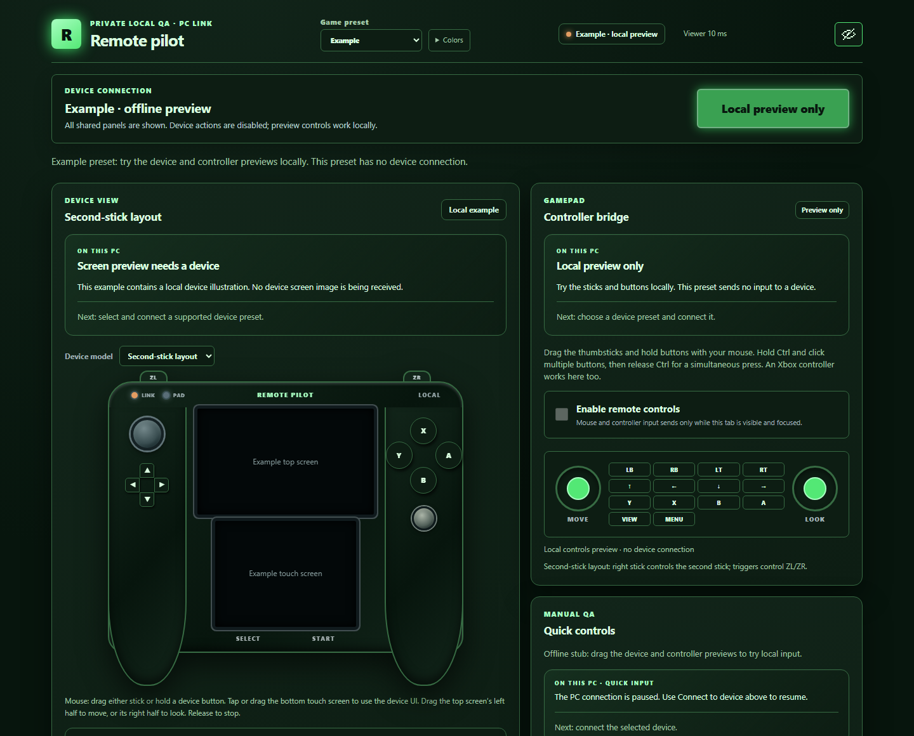

# Using the web viewer

[Home](Home.md) › Using the web viewer

**On this page:** [The page at a glance](#the-page-at-a-glance) · [Header](#header) ·
[Device view](#device-view) · [Chromatic tools](#chromatic-tools) ·
[Logs, console and firmware](#logs-console-and-firmware) · [The Example preset](#the-example-preset) ·
[Where files are saved](#where-files-are-saved)

All pictures on this page come from the built-in simulator, with the privacy eye on.

## The page at a glance

- **Top bar**: preset menu, colours, connection badge, privacy eye.
- **Device connection** (red frame): whether the console is connected, and **Connect / Disconnect**.
- **Device view** (green frame, left): the console with its live screen, and the buttons.
- **Chromatic tools** (blue frame, right): the connection choice, facts about the console, and
  **What works**, a list of every feature with its real state (*Available*, *Waiting*, *Needs FPGA
  update*...).

Hover over anything (or move to it with the keyboard): a short tooltip explains it in plain words.

## Header

- **Game preset**: choose **ModRetro Chromatic** (or **Example**, a local demo).
- **Colors**: change four page colours for this preset; **Restore preset colors** undoes it.
  Saved only on this PC.
- **Connection badge**: green when the console is connected.
- **Privacy eye** (top right): **on by default**. It hides addresses, network names, device IDs,
  pairing codes and folder names as `****` on the page, so screenshots are safe to share. Click to
  show them. It only changes what is drawn: saved files keep the real text.

## Device view

- **Live video** shows the console screen; choose up to 15 fps. **Screenshot** saves one picture.
- **Enable remote controls** must be ticked before buttons are sent. It only works while this tab is
  visible and focused, and the console's own buttons always win.
- Click a drawn button for one short press. Hold the mouse to hold the button. Hold **Ctrl**, click
  several buttons, then release Ctrl for a chord. The **Menu** nub on the right side is clickable.
- **Game controller**: tick it to use a controller plugged into the PC (D-pad, A, B, Start, Select).
- **Timing** shows how fast the launcher draws.

## Chromatic tools

- **Connection**: *Configured* (your real console from `local\chromatic\config.json`), the
  simulators, or *Off*.
- **Pair over USB** appears when the console has no key for this PC (see
  [Pairing](Pairing-with-a-Chromatic.md)).
- **Facts** list the launcher version, phase (launcher or game), which part owns the screen, the
  link in use and the last contact.

## Logs, console and firmware

- **Logs and diagnostics**: save a copy of the console's log lines, clear the received lines, and
  **Collect** the device log, status, console output or Manager files into one saved file.
- **Device console (read only)**: run one of a fixed list of safe commands (help, version, uptime,
  heap, wifi, phase, reset-reason).
- **Firmware patching (Chromatic Manager)**: starts Jellymatic's Chromatic Manager for status,
  backup, install, remove or restore-stock. It works only from this PC's own browser, only after you
  type the exact phrase shown (for example `READ CHROMATIC`), one job at a time, and with no cancel
  button (stopping a firmware write half way is what the Manager's journal is there to recover
  from). **Only use it with the console in front of you and plugged in.**
- **Activity**: everything the panel did, newest last. Errors are red.

## The Example preset

**Example** is a local demo of the shared controls with a generic two-screen drawing. It never
connects to anything; use it to try the sticks, buttons and controller preview.

## Where files are saved

Everything goes in the `local\` folder of your Remote Pilot folder, which Git ignores:

| What | Where |
| --- | --- |
| Screenshots, capture bundles, reports, log copies | `local\captures\` |
| Chromatic settings and pairing key | `local\chromatic\config.json`, `local\chromatic\pairing.json` |
| Chromatic Manager job output | `local\chromatic\manager-jobs\` |
| Your colour choices and last preset | `local\themes.json`, `local\selected-preset.json` |

Saved files are **not** masked by the privacy eye. Check them before sharing.

Next: [Using it with AI assistants](Using-with-AI-assistants.md)
